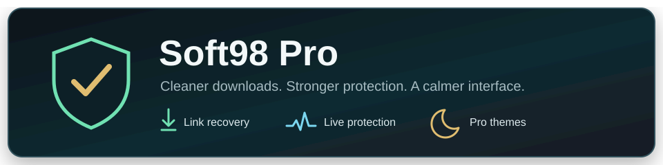
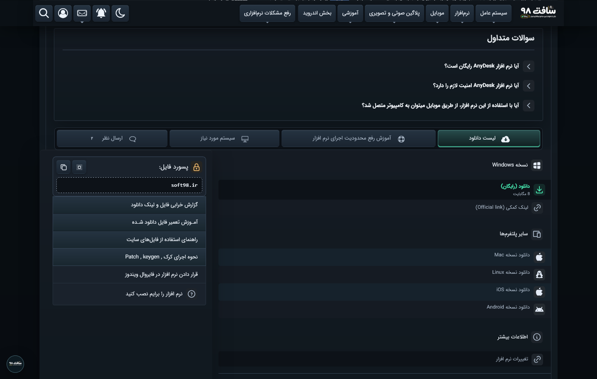

<a id="top"></a>

<div align="center" dir="rtl">

<a href="README.md"></a>&nbsp;
<a href="README.fa.md"></a>

[نسخهٔ انگلیسی مستندات](README.md)

<h1>سافت‌۹۸ پرو</h1>



[](https://github.com/DRSDavidSoft/soft98-pro/releases/latest)
[](https://github.com/DRSDavidSoft/soft98-pro/actions/workflows/ci.yml)
[](LICENSE)
[](https://github.com/DRSDavidSoft/soft98-pro/stargazers)

</div>

<div dir="rtl">

<a id="screenshot"></a>

## 📸 تصویر نمونه



[عکس‌های قبل و بعد از بازطراحی صفحهٔ دانلود](docs/assets/comparison/README.md)

سافت‌۹۸، بدون شلوغی تبلیغات؛ با لینک‌های سالم، دانلود مرتب‌تر و رابط کاربری با قابلیت دارک‌مود

نسخهٔ سبک رو به‌صورت یوزراسکریپت نصب کن یا سراغ افزونهٔ مرورگر برو تا مدیر دانلود رو هم داشته باشی. هر دو روی Chrome، Edge و Firefox قابل استفاده‌ان و ابزارهای اصلی‌شون از [یک کد مشترک](src/runtime.js) ساخته می‌شه.

<a id="contents"></a>

## 🧭 فهرست مطالب

- [تصویر نمونه](#screenshot)
- [قابلیت‌ها](#features)
- [لوگوها](#bundled-branding)
- [شروع کار](#getting-started)
  - [راه‌اندازی یوزراسکریپت](#userscript-quick-start)
  - [راه‌اندازی افزونه مرورگر](#extension-quick-start)
- [یوزراسکریپت یا افزونه؟](#choose-a-format)
  - [یوزراسکریپت](#userscript-profile)
  - [افزونهٔ مرورگر](#extension-profile)
- [به‌روزرسانی‌ها](#updates)
- [زبان برنامه](#localization)
- [ساخت از سورس](#build-from-source)
- [تست و انتشار](#cicd)
- [عیب‌یابی](#diagnostics)
- [مستندات](#documentation)

<a id="features"></a>

## ✨ قابلیت‌ها

- **بدون تبلیغات مزاحم:** حذف بنرها از شروع بارگذاری، بدون دست زدن به متن مطلب
- **لینک‌های سالم:** جلوگیری از خراب شدن لینک‌های دانلود وقتی سایت ادبلاکر رو تشخیص می‌ده
- **هشدارهای کمتر:** حذف هشدارهای مزاحم خود سایت و فیلترهای خارجی مثل PersianBlocker
- **رابط کاربری با قابلیت دارک‌مود:** ظاهر روشن، تیره و RGB؛ حالت تیره از اول فعاله
- **مدیر دانلود:** صف دانلود، توقف و ادامه، سرعت و زمان باقی‌مانده؛ در نسخهٔ افزونه
- **مرور سریع:** از بخش «ظاهر» فعالش کن تا بین لیست‌ها بدون بارگیری دوباره جابه‌جا بشی
- **نظرها و پاسخ‌ها:** چیدمان تازه برای حالت روشن و تیره، با همون فرم اصلی سایت
- **لوگو و آیکن زبانه:** لوگوی هماهنگ با ظاهر سایت و چشمک کوتاه برای اعلان‌ها
- **فارسی و انگلیسی:** انتخاب خودکار زبان با توجه به تنظیمات مرورگر یا ساعت تهران

<a id="bundled-branding"></a>

## 🏴‍☠️ لوگوها

- [لوگوی صفحات روشن](docs/assets/soft98-pro-logo-light.png)
- [لوگوی دزد دریایی سافت‌۹۸ پرو](docs/assets/soft98-pro-logo-dark.png)، با شعار «یکی از تبلیغ‌دار ترین مراجع نرم‌افزاری ایران»

هر دو لوگو همراه بسته‌ان و برای نمایش‌شون لازم نیست مرورگر فایل دیگه‌ای بگیره.

<a id="getting-started"></a>

## 🚀 شروع کار

دنبال نصب سریع هستی؟ یوزراسکریپت رو بردار. مدیر دانلود هم می‌خوای؟ افزونه رو نصب کن.

<a id="userscript-quick-start"></a>

### ⚡ یوزراسکریپت

1. روی Chrome یا Edge، [Tampermonkey](https://tampermonkey.net) رو نصب کن؛ روی Firefox، [Violentmonkey](https://violentmonkey.github.io)
2. دکمهٔ نصب یوزراسکریپت رو بزن و نصب رو تأیید کن
3. سایت [سافت‌۹۸](https://soft98.ir) رو باز کن

[](https://github.com/DRSDavidSoft/soft98-pro/releases/latest/download/soft98-pro.user.js)

<a id="extension-quick-start"></a>

### 🧩 افزونه مرورگر

اول بستهٔ مخصوص مرورگرت رو از [آخرین نسخه](https://github.com/DRSDavidSoft/soft98-pro/releases/latest) بگیر و فایل ZIP رو از حالت فشرده دربیار.

#### 🟦 مرورگرهای Chrome یا Edge

1. صفحهٔ `chrome://extensions` یا `edge://extensions` رو باز کن
2. گزینهٔ **Developer mode** رو روشن کن
3. روی **Load unpacked** بزن و پوشهٔ افزونه رو انتخاب کن

#### 🟠 مرورگر Firefox

1. صفحهٔ `about:debugging#/runtime/this-firefox` رو باز کن
2. روی **Load Temporary Add-on** بزن و فایل `manifest.json` رو انتخاب کن

برای جزئیات بیشتر، [راهنمای نصب](docs/wiki/fa/Installation.md) رو ببین.

### ✅ بعد از نصب

1. یه مطلب دانلود باز کن؛ متن و لینک‌ها باید سر جاشون باشن، بدون بنرها و هشدارهای مزاحم
2. از دکمهٔ شناور، مرکز کنترل رو باز کن؛ حالت پرو و دارک‌مود از اول روشنن
3. اگه صفحه از قبل باز بوده، یک بار تازه‌اش کن
4. برای دانلود، در نسخهٔ افزونه از زبانهٔ **دانلودها** در مرکز کنترل استفاده کن؛ دکمهٔ **+** کنار لینک مستقیم هم همون فایل رو به مدیر دانلود می‌فرسته
5. اگه چیزی درست کار نکرد، **گزارش فنی** رو همراه [گزارش مشکل](https://github.com/DRSDavidSoft/soft98-pro/issues/new/choose) بفرست

<a id="choose-a-format"></a>

## 🧩 یوزراسکریپت یا افزونه؟

<a id="userscript-profile"></a>

### ⚡ یوزراسکریپت

- **مناسب برای:** نصب سریع، مخصوصاً اگه از قبل Tampermonkey یا Violentmonkey داری
- **راه‌اندازی:** یک فایل
- **آپدیت:** خود مدیر یوزراسکریپت نسخهٔ تازه رو می‌گیره
- **محدودیت:** بدون مدیر دانلود افزونه و بدون دسترسی به تنظیمات عمیق‌تر مرورگر

<a id="extension-profile"></a>

### 🧩 افزونه مرورگر

- **مناسب برای:** استفادهٔ روزمره با مدیر دانلود و تنظیمات مرورگر
- **راه‌اندازی:** بستهٔ ZIP مخصوص Chrome و Edge یا Firefox
- **آپدیت:** افزونه خبر می‌ده؛ بستهٔ تازه رو خودت نصب کن
- **مزیت:** کنترل بیشتر روی تبلیغات و هشدارهایی که افزونه‌های دیگه اضافه می‌کنن

[مقایسهٔ کامل یوزراسکریپت و افزونه](docs/wiki/fa/Userscript-vs-Extension.md)

<a id="updates"></a>

## 🔄 به‌روزرسانی‌ها

- مدیر یوزراسکریپت نسخهٔ تازه رو از گیت‌هاب می‌گیره
- افزونه موقع نصب، باز شدن مرورگر و بعدش هر شش ساعت دنبال نسخهٔ تازه می‌گرده
- مرورگر اجازه نمی‌ده نسخه‌ای که دستی نصب شده خودش رو بی‌صدا عوض کنه؛ برای آپدیت، بستهٔ تازهٔ همون مرورگر رو بگیر و نصب کن

اگه PersianBlocker فعاله و هنوز هشدارش رو می‌بینی، نسخهٔ افزونه رو نصب کن. یوزراسکریپت می‌تونه هشدارهای عادی صفحه رو برداره، اما روی بعضی هشدارهایی که خود مرورگر اضافه می‌کنه دسترسی لازم رو نداره.

<a id="localization"></a>

## 🌐 زبان برنامه

اگه زبان مرورگر فارسیه یا منطقهٔ زمانی روی تهران تنظیم شده، برنامه فارسی باز می‌شه؛ وگرنه انگلیسیه. متن‌ها هم داخل بسته‌ان: [متن‌های برنامه](src/messages.json) و [متن‌های مدیر دانلود](src/ui/downloads.messages.json)

<a id="build-from-source"></a>

## 🛠️ ساخت از سورس

```bash
git clone https://github.com/DRSDavidSoft/soft98-pro.git
cd soft98-pro
npm ci
npm run ci
```

برای گرفتن عکس تازه، اول `geckodriver --port 44983` رو اجرا کن، بعد این دو دستور رو بزن:

```bash
npm run build
npm run screenshot:firefox
```

### 📦 خروجی‌های ساخت

- فایل [`soft98-pro.user.js`](soft98-pro.user.js): یوزراسکریپت آمادهٔ نصب
- پوشهٔ `dist/chromium/`: افزونهٔ Chrome و Edge
- پوشهٔ `dist/firefox/`: افزونهٔ Firefox
- پوشهٔ `dist/packages/`: بسته‌های ZIP آمادهٔ نصب
- پوشهٔ `dist/release/`: یادداشت انتشار، اطلاعات آپدیت و هش فایل‌ها
- تصویر [نمای دارک‌مود](docs/assets/soft98-pro-dark.png): عکس سایت با افزونهٔ فعال

<a id="cicd"></a>

## ⚙️ تست و انتشار

- **تست:** گیت‌هاب برای هر درخواست ادغام بسته‌ها رو می‌سازه و تست‌ها رو اجرا می‌کنه
- **انتشار:** بعد از تأیید، گردش‌کار انتشار رو روی شاخهٔ `main` دستی اجرا کن؛ ادغام به‌تنهایی نسخه منتشر نمی‌کنه
- [جزئیات تست و انتشار](docs/wiki/CI-CD-and-Releases.md)

<a id="diagnostics"></a>

## 🩺 عیب‌یابی

برای بررسی دقیق‌تر، کنسول مرورگر رو توی یکی از صفحات سافت‌۹۸ باز کن:

```js
window.Soft98AdBlocker.report()
window.Soft98AdBlocker.trapCheck()
window.Soft98AdBlocker.resetHandles()
window.Soft98AdBlocker.events
window.Soft98AdBlocker.stats
```

برای دیدن اسم بخش‌های صفحه، دستور `Soft98Pro.inspectedRoles()` رو بزن. برای نمونه‌های بیشتر، [راهنمای عیب‌یابی](docs/wiki/fa/Diagnostics.md) رو ببین.

<a id="documentation"></a>

## 📚 مستندات

- [خانهٔ ویکی](docs/wiki/fa/Home.md)
- [راهنمای نصب](docs/wiki/fa/Installation.md)
- [فرق یوزراسکریپت و افزونه](docs/wiki/fa/Userscript-vs-Extension.md)
- [کنسول و عیب‌یابی](docs/wiki/fa/Diagnostics.md)
- [ساخت، تست و مشارکت](docs/wiki/fa/Development.md)
- [راهنمای نوشتن مستندات](docs/Documentation-Style-Guide.md)
- [کارهای بعدی پروژه](docs/ROADMAP.fa.md)
- [نسخهٔ انگلیسی](README.md)

---

</div>

<div align="center" dir="rtl">

پروژه Soft98 Pro · یوزراسکریپت و افزونه مرورگر

[⬆ بازگشت به بالا](#top)

</div>
