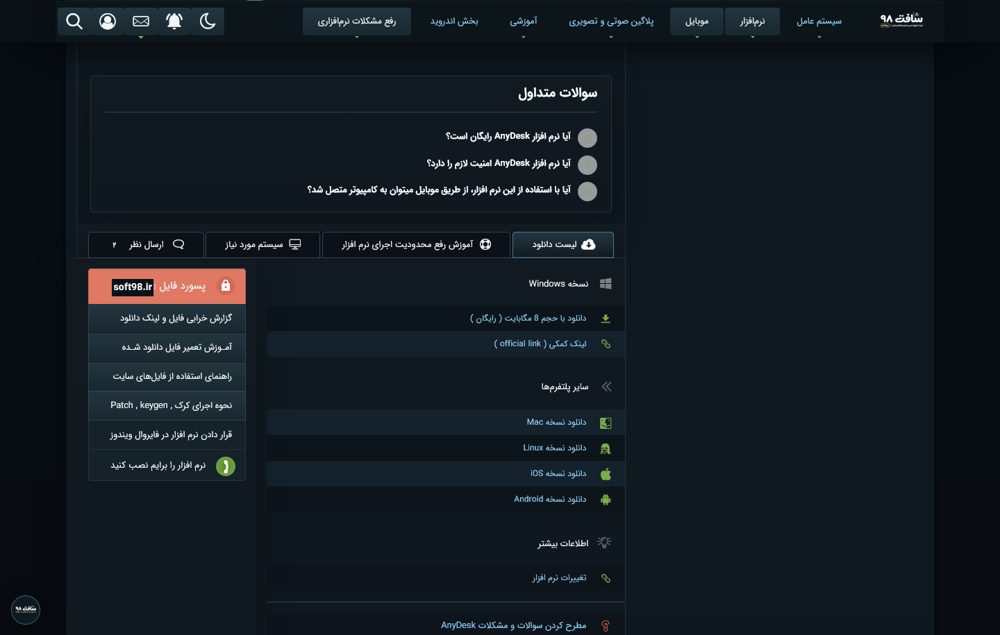
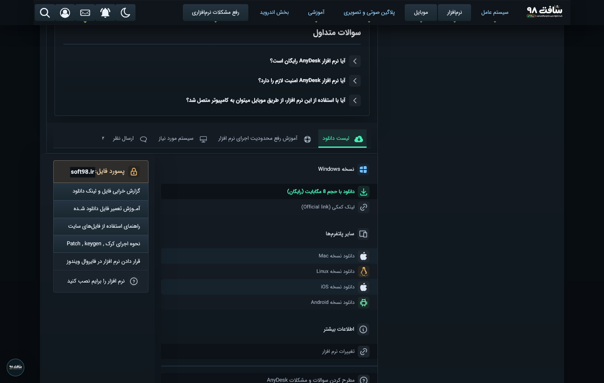

# Live Soft98 comparison

The desktop captures show the live AnyDesk page in separate, unsigned-in Firefox profiles. The previous Pro and current Pro images show the same download section with the control panel closed.

| Previous Soft98 Pro | Current Soft98 Pro |
| --- | --- |
|  |  |

See also: [narrow-screen view](downloads-mobile-after.png), [stock download page](downloads-before.png), [stock utility card](utility-before.png), [Pro utility card](utility-after.png), and [Pro page header](header-after.png).

The platform artwork is bundled locally from [Tabler Icons](https://github.com/tabler/tabler-icons) (MIT) and [Simple Icons](https://simpleicons.org/) (Linux icon, CC0 1.0). The marks belong to their respective owners.
