<!-- Generated by tools/comparison-gallery.js. Run npm run docs:comparison to refresh. -->
# Soft98 vs Soft98 Pro

The same [AnyDesk download tab](https://soft98.ir/internet/remote-control/15737-anydesk-download.html) captured in two clean Firefox profiles at the same window size. The control panel is closed.

## Before: Stock Soft98

Live Soft98 as served to a clean browser: no Soft98 Pro, userscript, ad blocker, or injected styles.

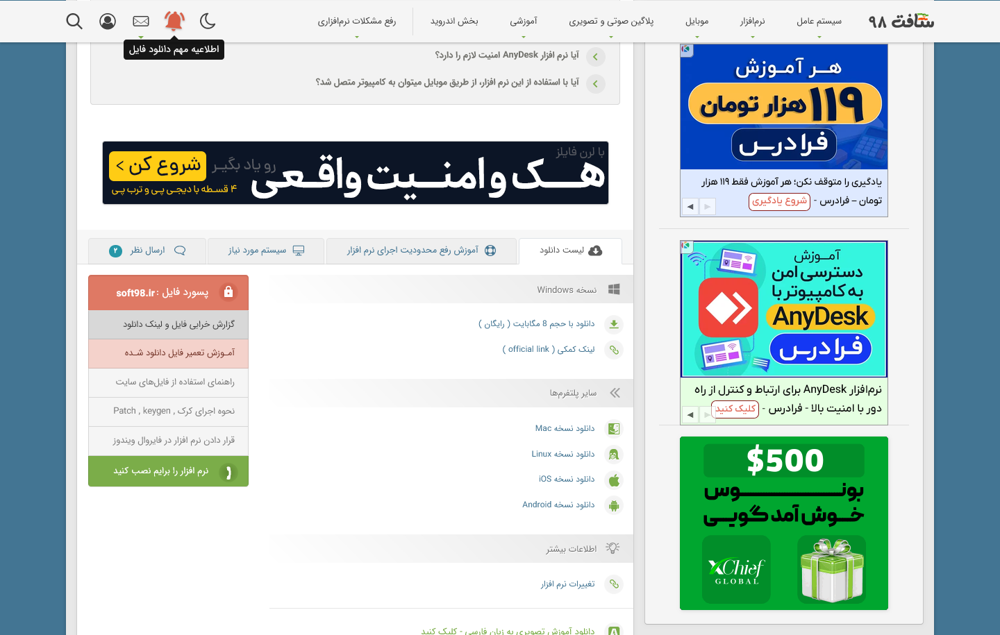

## After: Soft98 Pro

The live download tab with the Soft98 Pro extension installed and its default settings enabled.

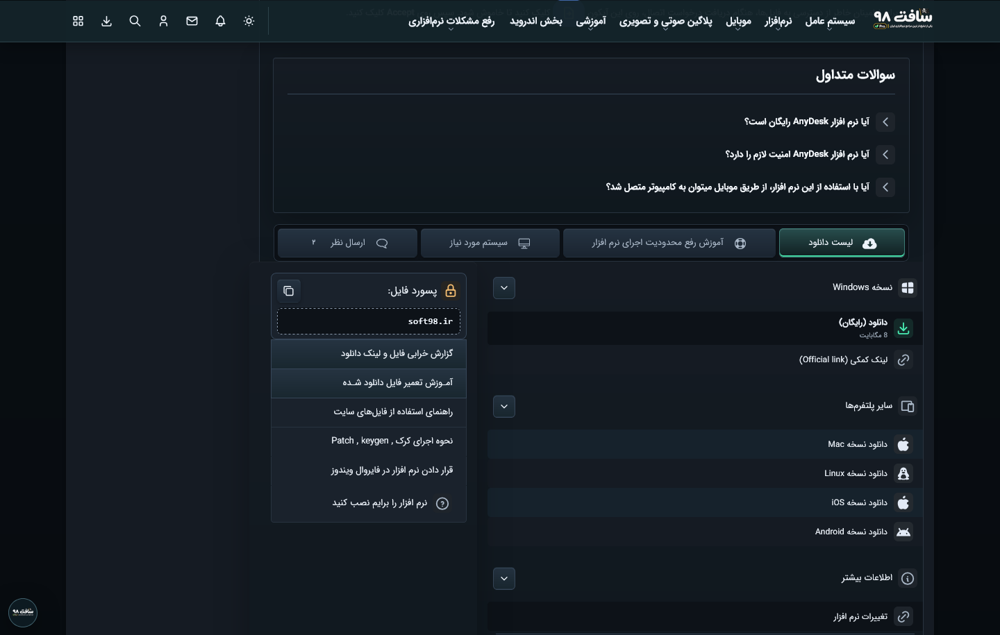

## Individual switches

Expand a section for its Off and On views. These compare one setting inside Soft98 Pro, keeping the other relevant settings fixed. Off here does not mean the extension was uninstalled. Illustrations are labeled where a live still does not reliably show the behavior.

<strong>Structural ad blocking</strong>

Remove advertising surfaces using source, geometry, and behavior signals.

Live screenshots. With the switch off, the advertising cards remain beside the article. The ads themselves vary by visit.

**Off**

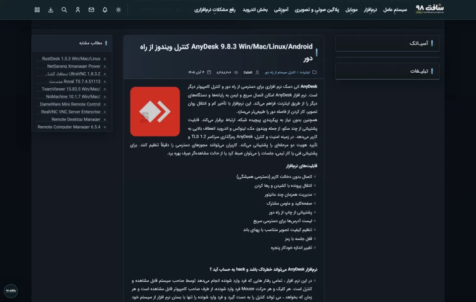

**On**

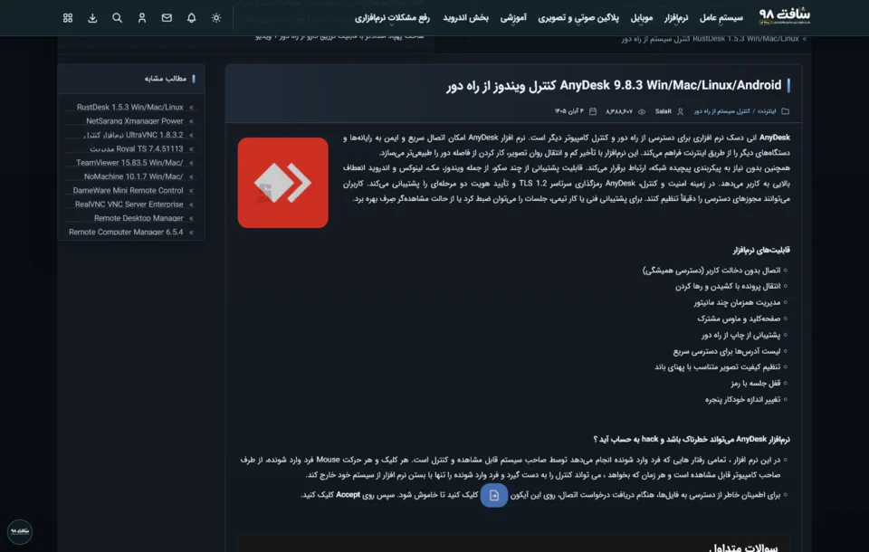

<strong>Modification engine</strong>

Inspect, unpack, and safely patch Soft98 application code before execution.

Illustration. The difference is in how the original script runs, not in the switch's appearance.

**Off**

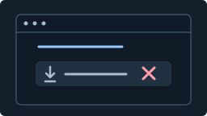

**On**

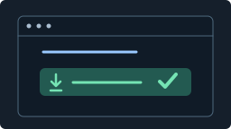

<strong>Soft98 Pro experience</strong>

Enable the enhanced interface and responsive experience layer.

Live screenshots. Turning off this switch leaves the selected protection options running; it is not stock Soft98.

**Off**

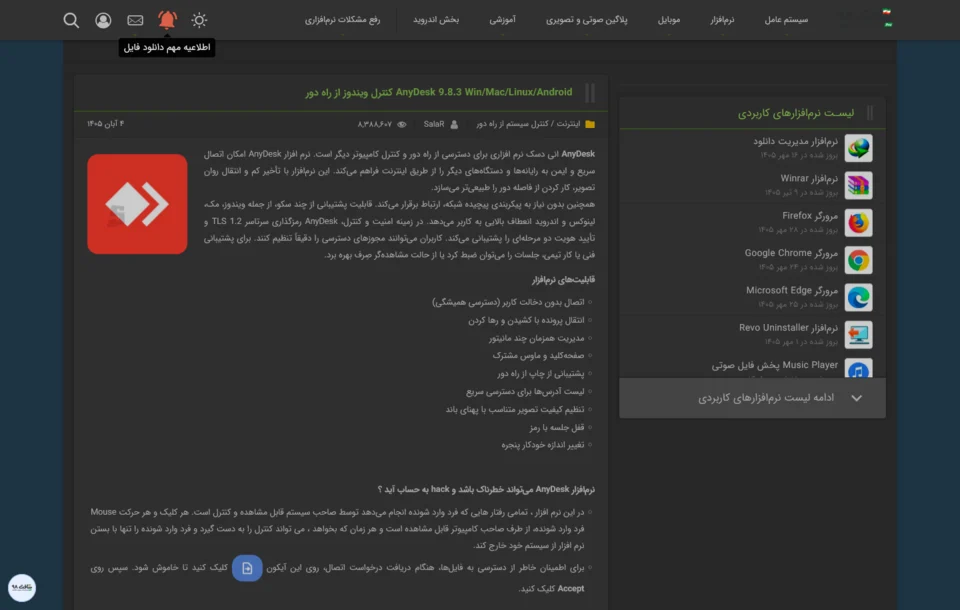

**On**

<strong>Dark theme</strong>

Switch between the Pro light and dark palettes. Pro tools stay on.

Live screenshots. Off uses the Pro light palette, not the stock site.

**Off**

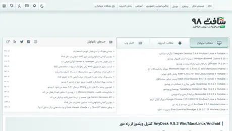

**On**

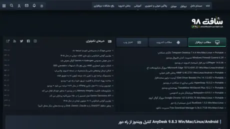

<strong>Animated RGB atmosphere</strong>

Add restrained spectral glass effects with reduced-motion support.

Live capture. The On preview animates; the still is available below in the same comparison.

**Off**

**On**

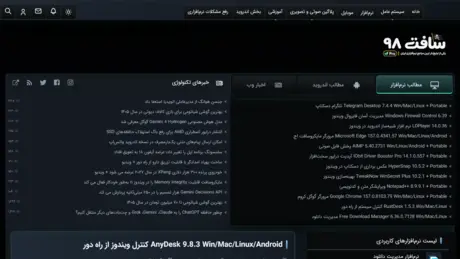

[View a still frame](../settings/rgb-still.webp)

<strong>Refined content layout</strong>

Reorganize primary content and supporting information responsively.

Live screenshots.

**Off**

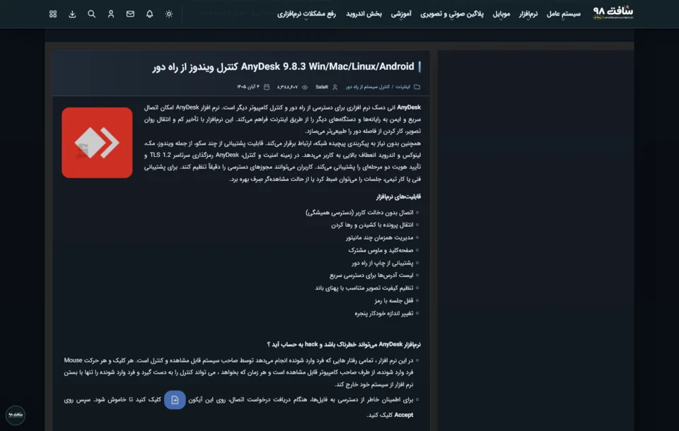

**On**

<strong>Wide-screen columns</strong>

Move related posts and downloads into side columns when there is room.

Live screenshots at 2304 px, with Refined content layout enabled. On places related posts and downloads alongside the article.

**Off**

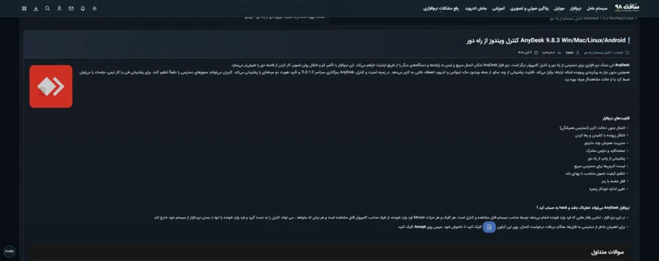

**On**

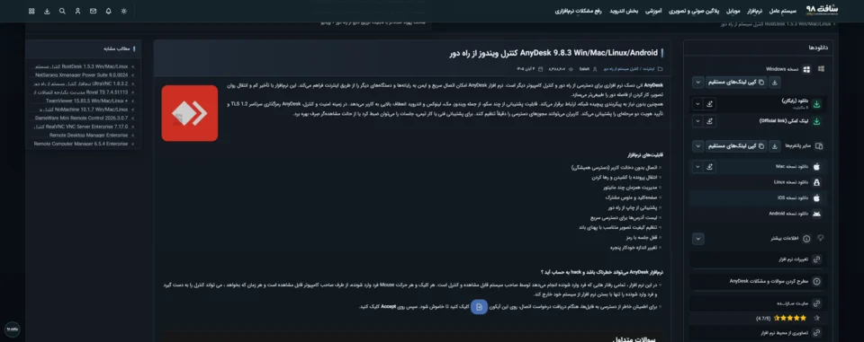

<strong>Widen article on scroll</strong>

Widen the article as you scroll past the sidebar.

Live screenshots taken after scrolling past the sidebar with Refined content layout enabled.

**Off**

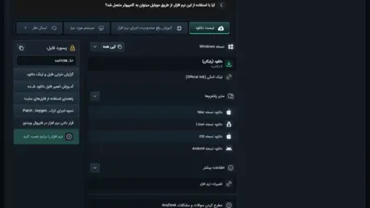

**On**

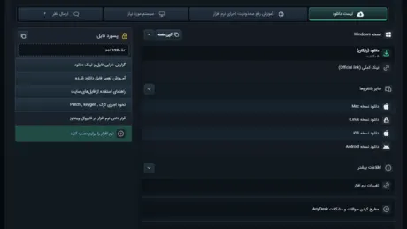

<strong>Useful software in the top bar</strong>

Move the utility list out of the sidebar and open it from the top bar.

Live screenshots. Off keeps Useful software beside the article; On moves it into a dialog opened from the top bar.

**Off**

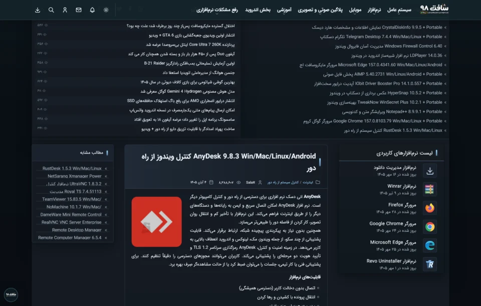

**On**

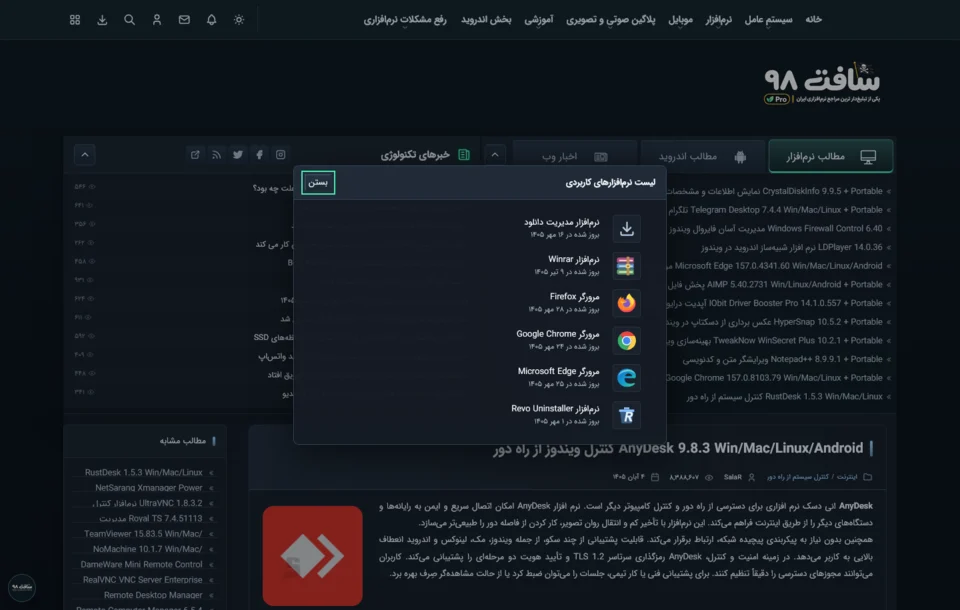

<strong>Quick browsing</strong>

Load software lists without reloading the page. Articles still open normally.

Illustration. Off reloads the listing page; On replaces the listing without a full reload.

**Off**

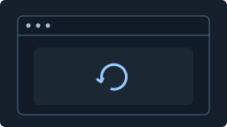

**On**

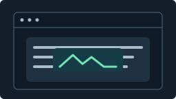

<strong>Interface sounds</strong>

Play a short, quiet sound when you use a control.

Illustration. This switch changes audio, which a still image cannot show.

**Off**

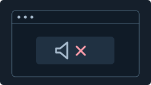

**On**

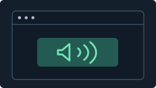

<strong>Show latest posts and news</strong>

Keep the latest software, Android posts, and news at the top of the page.

Live screenshots.

**Off**

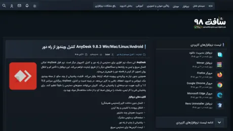

**On**

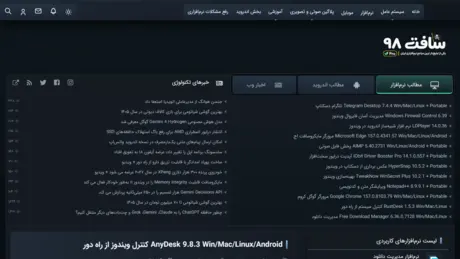

<strong>Hide extra site prompts</strong>

Hide the utility-list expansion prompt and the offer to install software for you.

Live screenshots. Look for the offer to install the software at the bottom of the password and help panel.

**Off**

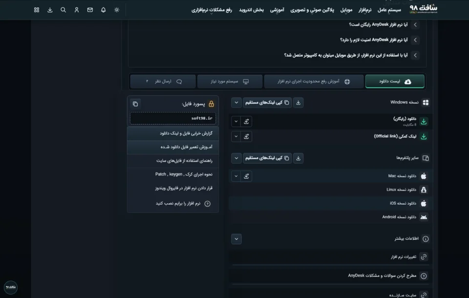

**On**

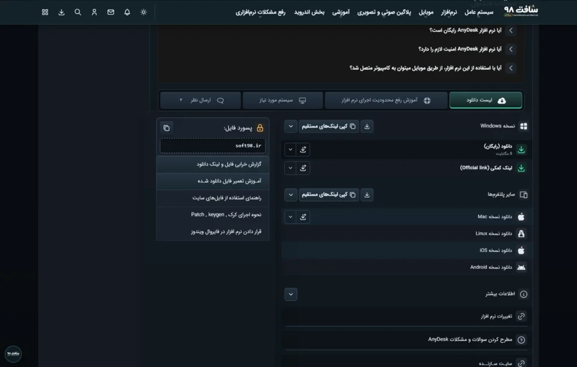

<strong>Pirate branding</strong>

Use the bundled transparent pirate identity after successful protection.

Live screenshots.

**Off**

**On**

<strong>Success notification</strong>

Briefly show a message after cleanup. Off by default.

Illustration. The success message appears briefly after cleanup, not permanently.

**Off**

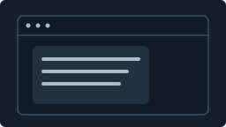

**On**

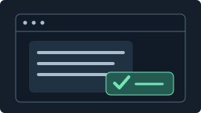

<strong>Console telemetry</strong>

Record patch outcomes, recovered links, and structural decisions.

Illustration. The output is in the console, not on the page.

**Off**

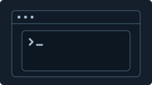

**On**

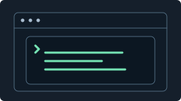

<strong>Extension recommendation</strong>

Recommend the fuller browser extension when the userscript is installed.

Illustration. This recommendation applies to the userscript, not the browser extension.

**Off**

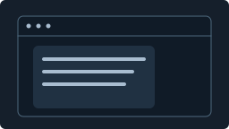

**On**

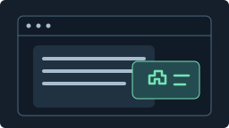

## More views

- [Narrow-screen download view](downloads-mobile-after.png) and [ultrawide layout](header-ultrawide.png)
- [Windows 11 listing](windows-listing.png) and [expanded article](article-expanded.png)
- [Stock utility card](utility-before.png) and [Pro utility card](utility-after.png)
- [Download manager and multipart archives](../../wiki/Download-Manager.md)
- [Platform and product artwork sources and licenses](../../../src/assets/utility/README.md)

Platform artwork includes [Tabler Icons](https://github.com/tabler/tabler-icons) (MIT), [Simple Icons](https://simpleicons.org/) (CC0), and original Soft98 Pro artwork. Product marks belong to their respective owners.
