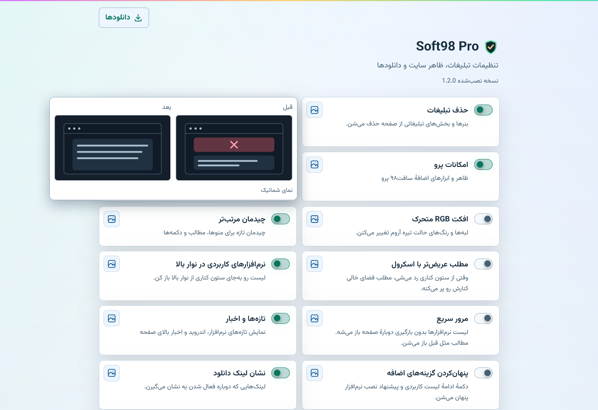
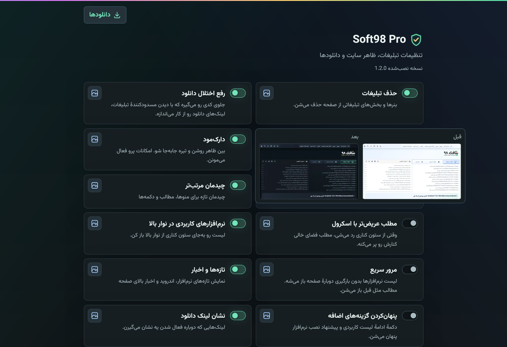
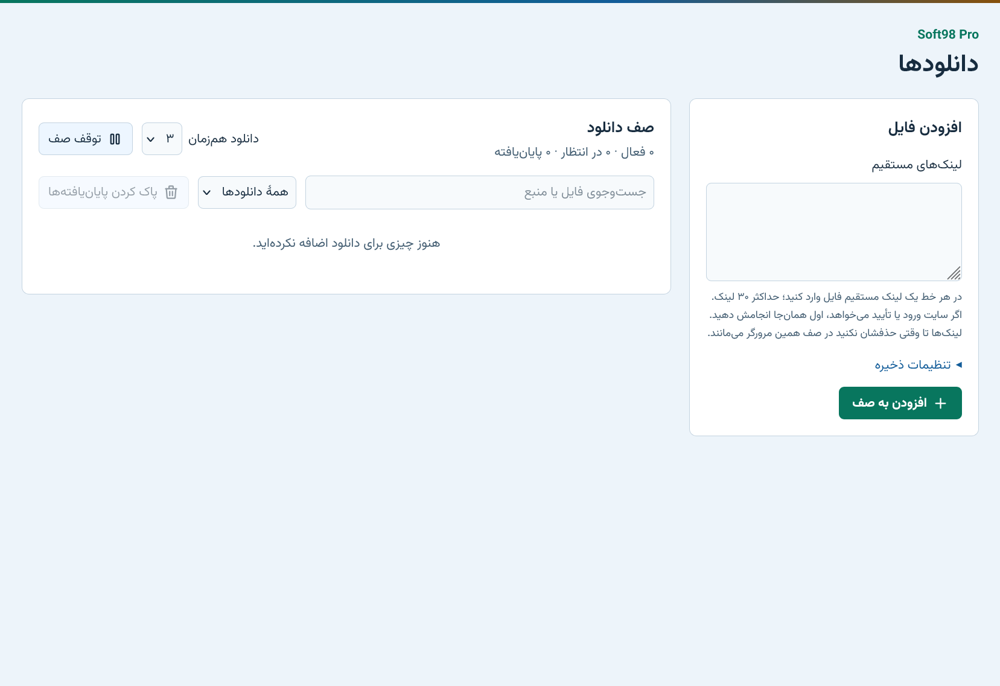
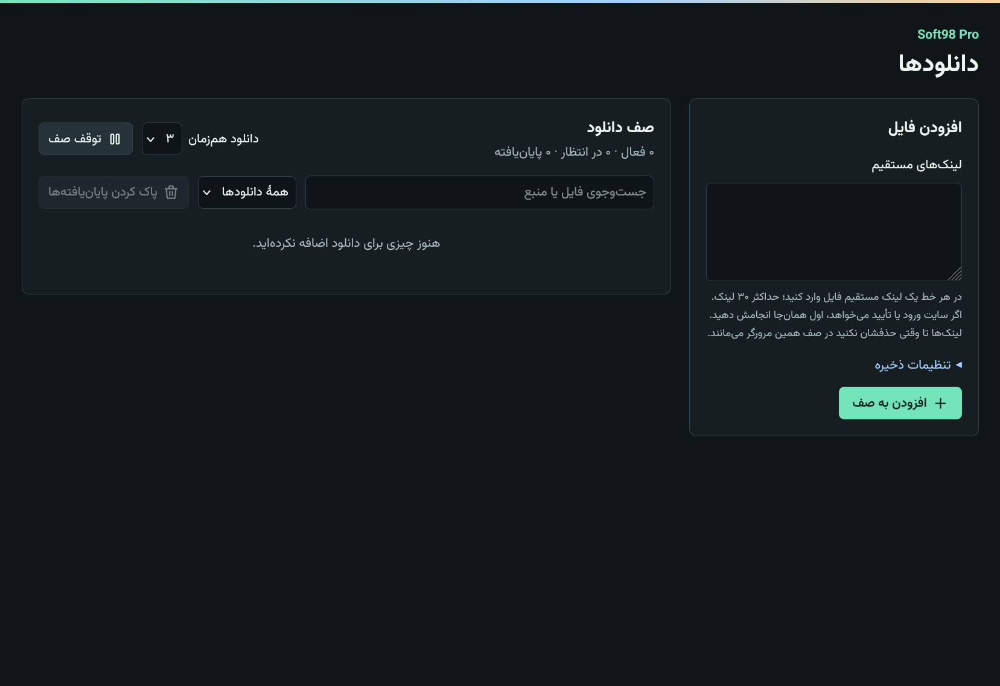

# Soft98 Pro v1.2.1

## Settings previews

Real captures show changes you can see on the page, such as the dark theme and the RGB effect. Labeled illustrations explain what happens when a screenshot would show only a switch changing state.

## Downloads in both themes

The Download Manager follows the site's Pro theme, as do Settings and the toolbar popup.

