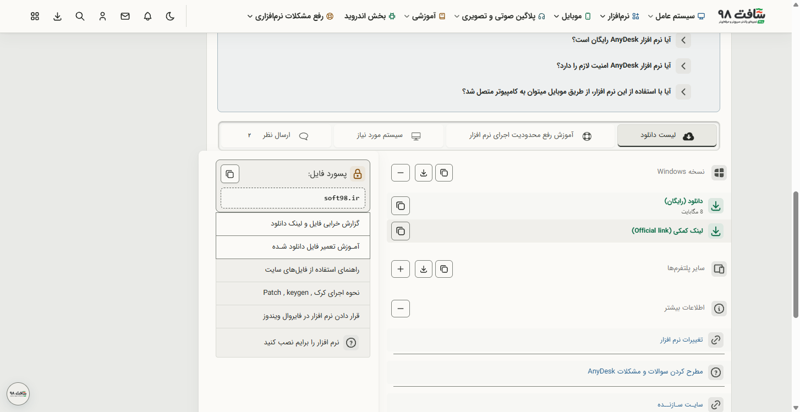

# Soft98 Pro v1.2.3

## Reliable Download Links

This release preserves Chromium's native application-script loading order and recovers the original article and file links when the site clears them during startup or an ordinary reload. It also handles download panes clipped to zero height.

The current Soft98 script was fetched and audited on November 18, 2026. Its hash and reviewed patches are unchanged. These fixes address the extension's startup and recovery behavior; they are not evidence of a new upstream countermeasure.

## Light Theme

A soft stone backdrop separates the lighter cards from the page. Headings have their own surface, and small semantic accents distinguish downloads, links, notices, and errors.

## Dark Theme

The same live article and its download links, with the dark theme enabled.

## Downloads and Navigation

- Queue, start, and copy actions share state with the Download Manager and toolbar popup.
- Review pasted links or text files, inspect file details, filter the list, and select the files to download.
- Multipart archives are grouped, and source-page links are retained.
- Download All includes a file picker and a confirmation step.
- News, search, page navigation, and responsive side columns have persistent controls.

See the [full changelog](../../CHANGELOG.md#123---2026-11-18), [Download Manager guide](../wiki/Download-Manager.md), and [feature comparisons](../assets/comparison/README.md).

## Capture Details

The screenshots show the live AnyDesk page in isolated Chromium 157.0.8103.79 with the v1.2.3 unpacked extension, the Control Center closed, and RGB mode disabled. Six visible download links retained valid HTTP(S) destinations in each theme. No file was downloaded for these captures.

Firefox packages are unsigned temporary add-ons; this release does not claim Mozilla signing or Chrome Web Store publication.

A userscript-only home-page clearing problem after ordinary reload remains under investigation in [issue #16](https://github.com/DRSDavidSoft/soft98-pro/issues/16). The reporter confirmed that the browser extension works in that environment. Use the extension if affected; do not run both formats together.
