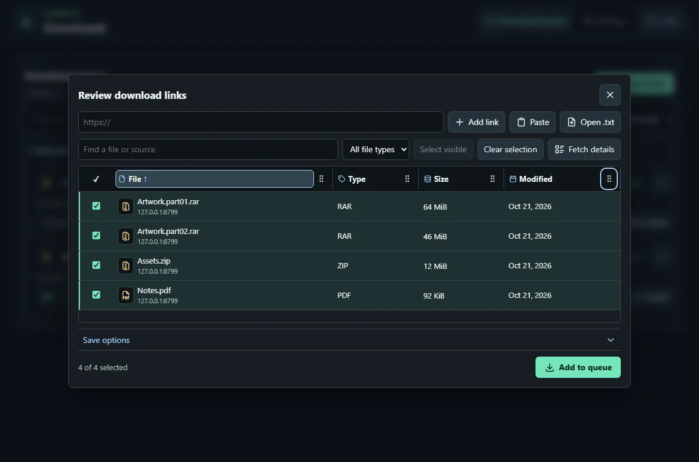
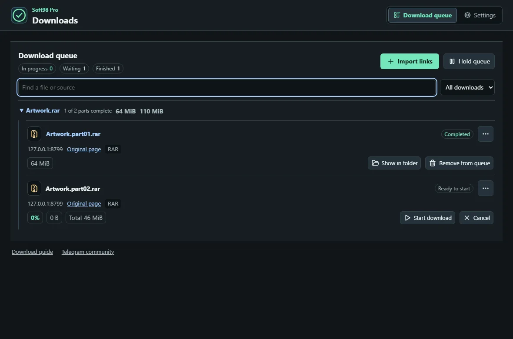

# Download Manager

[فارسی](fa/Download-Manager.md)

## Review links before downloading

Open **Download Manager** from the Soft98 header, footer, or Control Center. Paste with **Ctrl+V** or **Command+V**, or drop a plain text `.txt` file onto the manager. You can also use **Import links** to pick a text file or enter a single address. Nothing downloads until you submit the checked links.

- Search by file name or host, filter by type, and click a column heading to sort in either direction.
- Drag a column divider to resize it. With the divider focused, use the Left and Right arrow keys.
- **Select visible** checks the filtered rows. It keeps earlier selections, even if those rows are now filtered out. **Clear selection** unchecks all rows. Review up to 120 candidates and submit up to 30 per batch.
- Size, type, and last-modified date are checked automatically for selected links. **Fetch details** retries and may ask the browser for access to the selected sites. It sends HEAD requests without cookies or a referrer. Soft98's download CDN is covered automatically; cross-site restrictions, missing headers, or servers that reject HEAD can leave values unavailable without disabling the download. Persian mode shows dates in the Solar Hijri calendar.
- **Save options** lets you request a save prompt or enter a relative path for a single file.

## Follow downloads

Files such as `Artwork.part01.rar` and `Artwork.part02.rar` appear under one expandable group. Parts stay in numeric order and each keeps its own progress, pause, and cancel controls. **Original page** returns to the article when a download was added from there. Pasted links without a known source do not get a guessed origin page.

On a Soft98 article, use the row menu to queue, start, copy, or review one link, or the download icon beside a section heading to review the whole section. The original site link is unchanged. An article only shows a status badge when a file is actually tracked; the badge can show progress, completion, or a problem and opens the manager.

The **Wide-screen columns** setting is on by default. From 1280 CSS pixels, related posts can move to the left. On ultrawide screens (at least 1720 pixels and a 2:1 viewport, or 2200 pixels regardless of aspect ratio), a supported download list moves to the right once Soft98 supplies its links. Use **Go to downloads** on the original tab to reach it. Narrowing the window or switching off Wide-screen columns restores the original placement.

**Browser notifications** cover completion and downloads that need attention. They use the extension's background worker, so the manager does not need to stay open. Click a notification to open the corresponding queue entry. Turn them off in the manager, or control their delivery in your browser and system settings.

The screenshots show the actual packaged interface with sample files and local HEAD responses. To regenerate them in PowerShell, set `$env:SOFT98_DOWNLOAD_SCREENSHOTS='1'`, then run `npm run build` and `node test/runtime-browser.js`.
