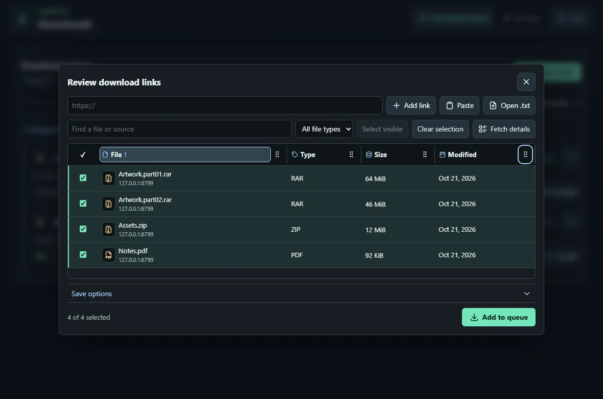
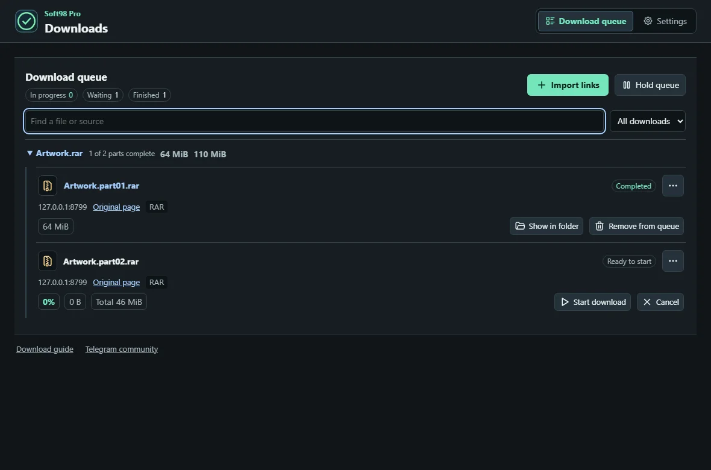

# مدیر دانلود

[راهنمای انگلیسی](../Download-Manager.md)

## بررسی لینک‌ها

مدیر دانلود رو از نوار بالا، فوتر یا مرکز کنترل سافت‌۹۸ باز کن. لینک‌ها رو با **Ctrl+V** یا **Command+V** بچسبون، یا یه فایل متنی با پسوند `.txt` بنداز روی صفحه. می‌تونی از **وارد کردن لینک‌ها** هم فایل متنی یا یه نشانی رو وارد کنی. تا فایل‌های انتخاب‌شده رو به صف اضافه نکنی، چیزی دانلود نمی‌شه.

با زدن آیکون سافت‌۹۸ پرو توی نوار مرورگر همون صف توی یه پنجرهٔ جمع‌وجور باز می‌شه. فلش بالای پنجره مدیر دانلود رو توی یه تب جدا باز می‌کنه. برای تنظیمات کلی افزونه روی اسم **سافت‌۹۸ پرو** بزن.

برای دیدن گزینه‌های هر فایل روی ردیفش راست‌کلیک کن یا وقتی گزینه‌ای از ردیف فعاله **Shift+F10** رو بزن. پنجرهٔ بررسی با **Escape** یا کلیک بیرونش بسته می‌شه. **راهنمای مدیر دانلود** هم بدون اینترنت باز می‌شه.

- برای پیدا کردن فایل، اسم یا میزبانش رو جست‌وجو کن. با انتخاب نوع فایل فهرست رو کوتاه کن، یا روی عنوان ستون بزن تا ترتیبش عوض بشه.
- برای تغییر عرض هر ستون، خط کنارش رو بکش. می‌تونی با کلیدهای چپ و راست هم عرض رو تغییر بدی.
- دکمهٔ **انتخاب موارد فیلترشده** فقط مواردی رو که می‌بینی به انتخاب اضافه می‌کنه. دکمهٔ **لغو همهٔ انتخاب‌ها** همه رو از انتخاب خارج می‌کنه. می‌تونی تا ۱۲۰ لینک رو بررسی کنی و هر بار تا ۳۰ فایل به صف بفرستی.
- نوع، حجم و تاریخ تغییر لینک‌های انتخاب‌شده خودکار بررسی می‌شن. اگه مشخصات نیومد، **گرفتن مشخصات فایل** رو بزن و اگه مرورگر خواست، به سایت فایل دسترسی بده. از کوکی برای بررسی استفاده نمی‌شه. اگه سرور مشخصات رو نده، همچنان می‌تونی فایل رو دانلود کنی.
- در **تنظیمات ذخیره** می‌تونی محل ذخیره رو از مرورگر بپرسی یا برای یه فایل، مسیر نسبی بدی.

## پیگیری دانلودها

قسمت‌های یک آرشیو مثل `Artwork.part01.rar` و `Artwork.part02.rar` کنار هم می‌مونن. هر قسمت رو می‌تونی جدا متوقف یا لغو کنی. برای برگشتن به مطلبی که لینک از اونجا اومده، **صفحهٔ اصلی فایل** رو بزن. اگه منبع لینک مشخص نباشه، پیوندی برای برگشت نمی‌بینی.

فایل دانلودشده با کلیک روی اسمش باز می‌شه. برای جست‌وجو **F2** رو بزن. پیشرفت دانلود رو کنار عنوان صفحه و روی آیکون تب هم می‌بینی. حجم فایل همیشه با عدد انگلیسی نمایش داده می‌شه. از تب **تنظیمات** می‌تونی تعداد دانلودهای هم‌زمان و اعلان‌ها رو عوض کنی یا موارد پایان‌یافته رو بدون پاک کردن فایل‌ها از صف برداری.

تاریخ‌های اخیر به شکلی مثل **۲ روز پیش** نشون داده می‌شن. برای دیدن تاریخ دقیق ماوس رو روی تاریخ ببر یا با کلید **Tab** انتخابش کن. از **تنظیمات ← تقویم تاریخ‌ها** می‌تونی حالت **خودکار** یا تقویم **شمسی** یا **میلادی** رو انتخاب کنی. توی حالت خودکار نوع تقویم از زبان برنامه مشخص می‌شه.

توی صفحهٔ مطلب، نشانگر ماوس رو روی دکمهٔ کنار لینک ببر تا فلش منو رو ببینی. با کیبورد هم می‌تونی بهش برسی و روی صفحهٔ لمسی فلش همیشه هست. از منو می‌تونی یه فایل رو به صف اضافه کنی، دانلودش رو شروع کنی، لینکش رو کپی کنی یا اول بررسیش کنی. **کپی همه** لینک‌های مستقیم بخش رو کپی می‌کنه و **دانلود همه** اول فهرست لینک‌ها رو برای بررسی باز می‌کنه. کنار لینک فقط وقتی نشون وضعیت می‌بینی که فایل توی مدیر دانلود ثبت شده باشه.

کنار فایل‌های توی صف می‌تونی وضعیت و حجم دانلودشده رو ببینی. اگه زمان باقی‌مونده معلوم باشه اون هم نشون داده می‌شه. توی **مرکز کنترل ← دانلودها** آمار کل صف رو می‌بینی اما فهرست فایل‌ها فقط مال همین صفحه‌ست. روی اسم فایل بزن تا همون مورد توی مدیر دانلود باز بشه.

گزینهٔ **ستون‌های نمایشگر عریض** از اول روشنه. وقتی جا باشه، مطالب مشابه به ستون چپ می‌رن. روی نمایشگر خیلی عریض، یه کادر دانلود دیگه هم سمت راست می‌بینی و فهرست اصلی توی مطلب سر جاش می‌مونه. با دکمه‌های **−** و **+** می‌تونی هر کدوم رو جدا باز و بسته کنی. با کوچیک کردن پنجره یا خاموش کردن گزینه، کادر اضافه برداشته می‌شه.

با **اعلان‌های مرورگر** می‌فهمی دانلود کامل شده یا به بررسی نیاز داره، حتی وقتی مدیر دانلود باز نیست. می‌تونی از تنظیمات مدیر دانلود خاموششون کنی.

تصاویر از رابط خود افزونه با فایل‌های نمونه گرفته شدن.
